[한국어](README.md) | [English](README-en.md)

<div align="center">

# AnyControl

**An input device built from a single camera — objects, pens and bare hands become a mouse, a keyboard and a gamepad.**

[](https://github.com/maboloar/anycontrol/releases)


Entry for the 2026 Korea University × AWS AI INNOVATORS CHALLENGE

[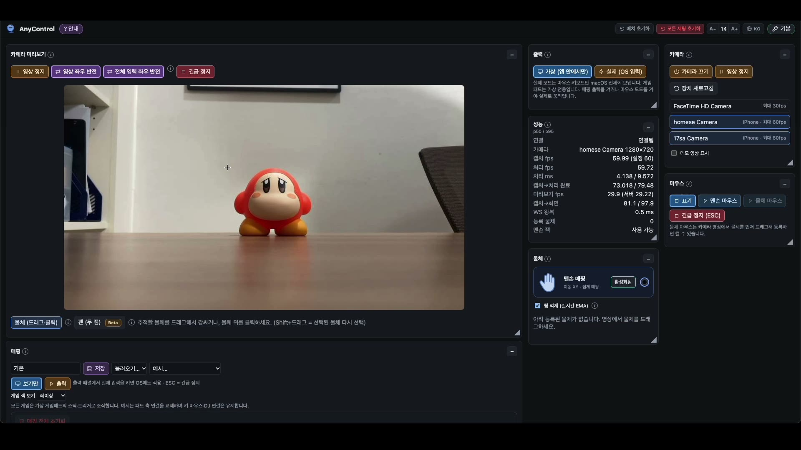](docs/media/demo.mp4)

▶ Click the image to play the full demo video (1 min 7 s).

</div>

---

## Contents

- [What is AnyControl?](#what-is-anycontrol)
- [Features](#features)
- [How it works](#how-it-works)
- [Practice games](#practice-games)
- [Screenshots](#screenshots)
- [Download and install](#download-and-install)
- [Requirements](#requirements)
- [How to use](#how-to-use)
- [Troubleshooting](#troubleshooting)
- [Third-party components](#third-party-components)

## What is AnyControl?

AnyControl is a **local macOS web app that tracks objects and hands with a camera and turns their movement into computer input.** With no extra sensors or dedicated controllers, ordinary things on your desk — a cup, a pen, a toy — work as a mouse, a keyboard or a gamepad.

- **No special hardware.** One camera is enough (an iPhone via Continuity Camera is recommended).
- **Recognizes several objects at once.** Connect a different function to each object, so two people can play on one screen.
- **Remembers hidden objects.** If an object is briefly covered by a hand or another object, AnyControl remembers it and finds it again.
- **Runs on device.** Video never leaves your Mac, and after the first install it works without internet.
- **Simple install.** Double-click the `.command` file and Python and the libraries are installed automatically.

## Features

### 1. Object tracking — register with one drag

Drag around an object in the camera video and tracking starts right away. Any object that stands out from the background works.

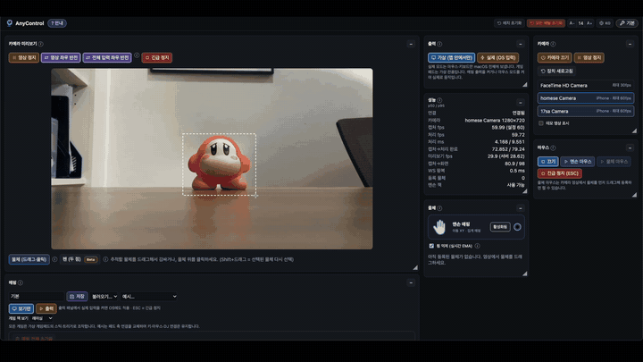

### 2. Mapping — connect an object to any input

Drag a jack on the object card to a function jack to connect a cable — that's the whole mapping. Click a cable to adjust input type, sensitivity and direction, and use **+ Add mapping** to create any key, mouse or gamepad output.

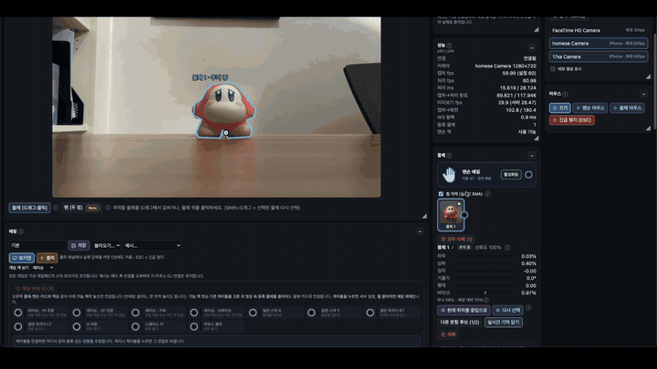

### 3. Multiple objects and occlusion recovery

Register several objects at once and connect each to a different function. When one is hidden by a hand or another object, it is remembered and tracking resumes when it reappears.

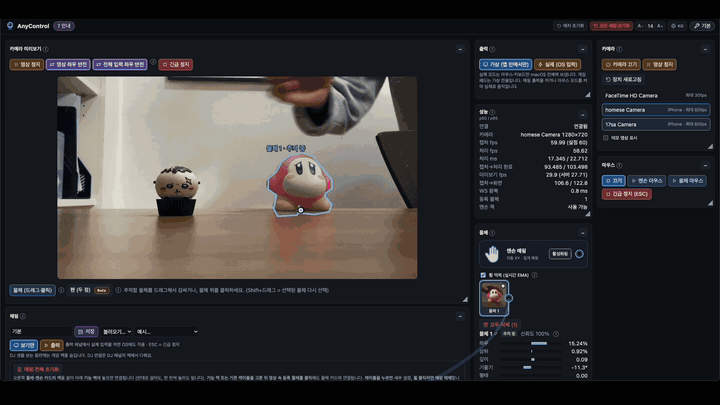

### 4. Object mouse and hand mouse

- **Object mouse:** sideways movement moves the cursor left/right, and toward/away from the camera moves it up/down. Click by lifting the object slightly or by connecting it to the **Mouse click** function.
- **Hand mouse:** the palm position moves the cursor.

| Gesture | Input |
|---|---|
| Thumb + index | Left press · drag |
| Thumb + middle | Right press |
| Index and middle raised, moving up/down | Scroll |

### 5. Object touch — cover it with your hand to press

Set a cable's input to **Hand touches object** and covering the object with your hand presses it like a button. A single object becomes a button.

### 6. Pen and hand drawing (Beta)

Draw in the air with an ordinary pen tip or your finger and the strokes appear on screen. Calibrate before use.

### 7. Real Mac control

Turn on **Output → Real (OS input)** and after 3 seconds the input AnyControl creates is sent to your actual Mac. You can practice safely in the **virtual desktop** first, and pressing `Esc` at any time stops output and releases all held keys and buttons.

### 8. Auto calibration and tutorial

- **Quick auto calibration:** hold still → sweep left-right → sweep near-far, and calibration is done.
- **Follow-along tutorial:** press **? Guide** next to the title for step-by-step help: register an object → connect a function → pick a game → auto-map → play.

## How it works

```
 Camera ──▶ Object tracking (EfficientTAM)  ─┐
        ──▶ Hand recognition (Apple Vision / MediaPipe) ─┤──▶ Mapping ──▶ Mouse · keyboard · gamepad output
        ──▶ Pen · depth estimation ──────────────────────┘          (virtual desktop / real OS input)
```

1. Objects and hands are tracked in real time from the camera video.
2. Movements such as position, tilt, lift and touch become input values.
3. Your mappings turn them into mouse, keyboard or gamepad output.

Everything is processed on your Mac. AnyControl consists of a local server and a browser UI, and closing the browser tab shuts it down.

## Practice games

Pick a game in the demo row at the bottom of the screen and press **Auto-map** to play right away. You can choose the number of players (1 by default), the controller and the control style.

| | |
|---|---|
| **Racing** | **Pong** |
| 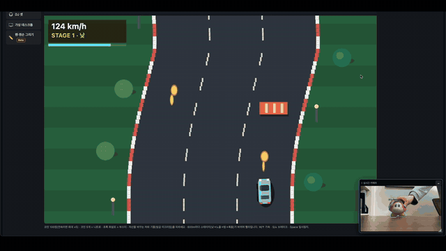 | 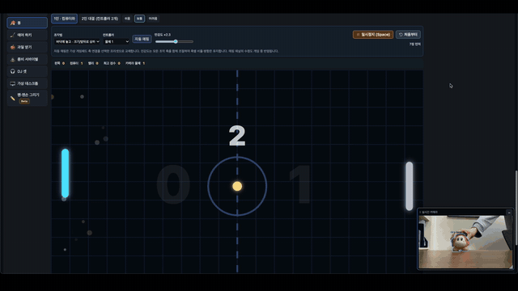 |
| **Air hockey** | **Fruit catch** |
| 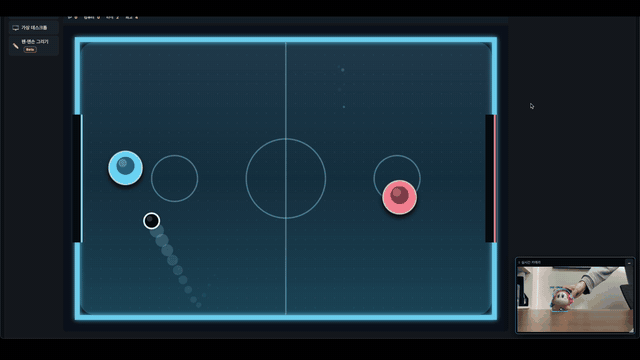 | 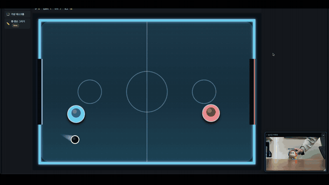 |

**Zombie survival**

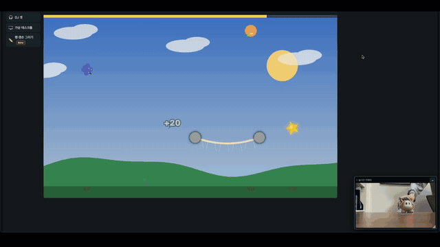

### DJ set

Press **Auto-map** to create the DJ connections. With 1 object: sideways = mix, near/far = volume, tilt = filter, lift = clap. With 2 objects, decks A/B are assigned left to right in the video and touch plays them.

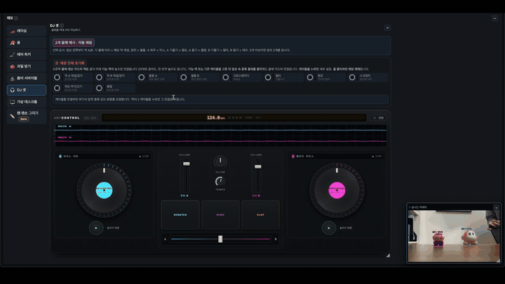

## Screenshots

| Object tracking | Mapping |
|---|---|
| 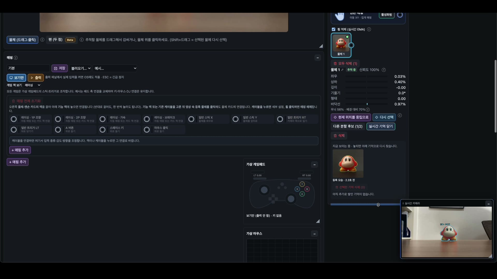 | 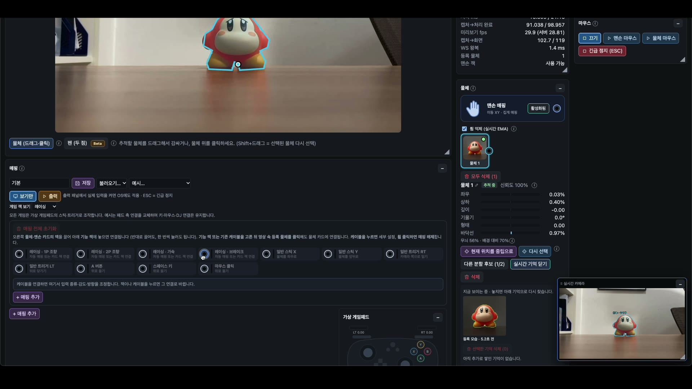 |
| **Multiple objects** | **DJ set** |
| 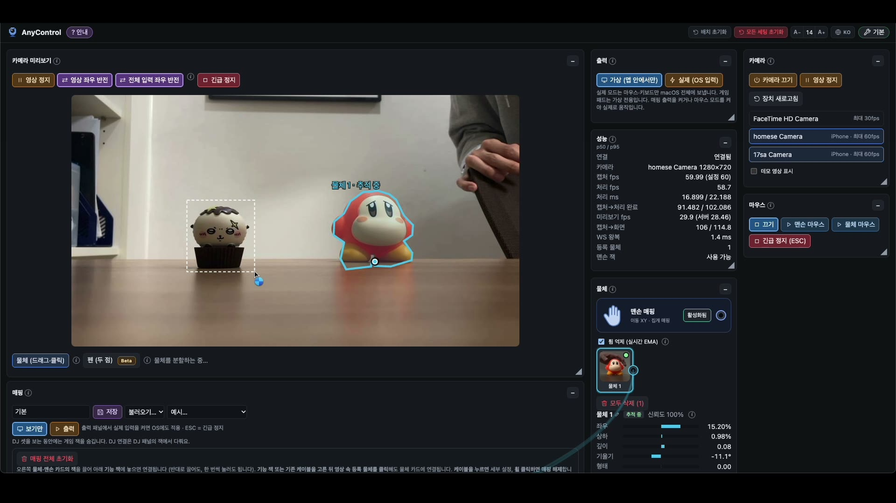 | 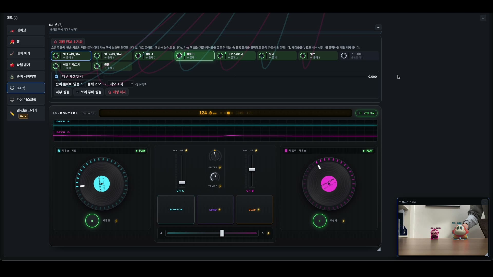 |

The service brochure is in [`introduction/`](introduction/) (Korean).

## Download and install

1. Download `AnyControl-v1.8.0-macOS.command` from [GitHub Releases](https://github.com/maboloar/anycontrol/releases). Also keep `AnyControl-Uninstall-v1.8.0-macOS.command`. **The Source code archives are not installers.**
2. Double-click the `.command`. If macOS blocks it or says you lack permission, follow the [first-launch guide](#first-launch-permissions). The first install takes a few minutes depending on your connection.
3. Allow camera access and AnyControl opens in your browser.

Python and all libraries install automatically; nothing is needed beforehand. It installs to `~/Library/Application Support/AnyControl/`, and saved mappings live in `profiles/`.

## Requirements

### To run

- **OS / device:** macOS 14 or later, Apple Silicon (M1 or later)
- **Memory:** 8 GB or more, 16 GB recommended
- **First install:** 4 GB of free disk space and internet
- **Camera:** required — an iPhone via Continuity Camera over USB is recommended
- **Permissions:** camera required; Accessibility to control the real mouse and keyboard
- **Offline use:** works without internet after the first install

### For development

- **Python:** 3.12 or later, 3.13 recommended
- **Node.js:** 22.12+ to build / 22.22.2+ or 24.15+ for tests

See the [development guide](DEVELOPMENT.md) for running from source, tests and building the launcher.

## iPhone as a webcam — Continuity Camera

Continuity Camera lets you use an iPhone as a Mac webcam. **A wired USB connection is recommended.** Requirements follow Apple's [Continuity Camera guide](https://support.apple.com/en-us/102546).

- iPhone XR or later with iOS 16 or later, both devices signed in to the **same Apple Account with two-factor authentication**.
- On the iPhone, turn on **Continuity Camera** in **Settings → General → AirPlay & Continuity**, and turn on Wi‑Fi and Bluetooth.
- Over USB, tap **Trust This Computer** on the iPhone.

Lock the iPhone and mount it so the rear camera faces the desk. At startup a connected iPhone is selected automatically first (a booth camera, if present, comes before it). Pick another device under **Camera → Refresh devices**.

## Quit and update

**Close the AnyControl browser tab to quit.** Close all tabs if you opened several; about 5 seconds later the server and the Terminal program exit. To use it again, double-click the same `.command`; to update, open the new release's launcher. Saved profiles are kept.

## Uninstall

Double-click `AnyControl-Uninstall-v1.8.0-macOS.command` and follow the prompts. It asks separately whether to delete saved profiles (kept by default). The downloaded `.command` files and macOS permission entries remain; remove them yourself if you like.

## Third-party components

Object tracking uses EfficientTAM; hand recognition uses Apple Vision (default) and MediaPipe (optional). Sources and licenses are in [third-party components](THIRD_PARTY.md).

## Troubleshooting

| Problem | Fix |
|---|---|
| The `.command` is blocked by security settings | Follow [1. Allow it in macOS security](#security-blocked). |
| "You do not have permission to open the application" | Follow [2. Make the file executable](#execution-permission), then double-click again. |
| Install fails or stalls | Check your connection and 4 GB of free space, then run the same file again. Logs are in `~/Library/Application Support/AnyControl/logs/`. |
| The browser doesn't open | Open the address shown in Terminal (default `http://127.0.0.1:8767`). |
| No camera or a black picture | Check macOS camera permission, quit other apps using the camera and press **Refresh devices**. |
| **The iPhone Continuity Camera is not in the device list** | **Connect the iPhone to the Mac with a USB cable**, tap **Trust This Computer** on the iPhone, then press **Refresh devices**. Also check the same Apple Account, Continuity Camera turned on, and Wi‑Fi/Bluetooth. |
| The real mouse/keyboard doesn't move | Allow it in **System Settings → Privacy & Security → Accessibility** and turn on real input in the app. |
| Tracking jitters or loses the object | Brighten the lighting and fix the camera in place. Use an object that stands out from the background and reselect it if needed. |
| Closing the tab doesn't quit | Check for other AnyControl tabs; if it keeps running, press `Ctrl+C` in Terminal. |

<a id="first-launch-permissions"></a>

### First launch: security block and execute permission

The first time you open a downloaded `.command`, these two errors may appear one after the other. Follow the step for the error you see. The launcher and uninstaller may each need it.

<a id="security-blocked"></a>

#### 1. Blocked by macOS security settings

This appears because the release is not signed or notarized.

1. Make sure you downloaded it from the [official GitHub Releases](https://github.com/maboloar/anycontrol/releases).
2. Double-click the `.command`, read the warning and close it.
3. In **Apple menu () → System Settings → Privacy & Security**, click **Open Anyway** under **Security**.
4. Choose **Open** and authenticate with your password or Touch ID.

Macs managed by a school or company may not allow this. See [Apple's guide](https://support.apple.com/en-us/102445).

<a id="execution-permission"></a>

#### 2. "You do not have permission to open the application"

The download lost its execute permission. Add it to that file only in Terminal.

1. Press `⌘ + Space` and open **Terminal**.
2. Type `chmod u+x ` (with a trailing space), drag the `.command` from Finder into the Terminal window, then press Enter.
3. Double-click the same `.command` again.

If the file is in **Downloads**, you can use this command as is.

```bash
chmod u+x "$HOME/Downloads/AnyControl-v1.8.0-macOS.command"
```

To repair libraries, run this in the launcher's folder:

```bash
./AnyControl-v1.8.0-macOS.command --repair
```

If that doesn't help, open a [GitHub Issue](https://github.com/maboloar/anycontrol/issues) with your macOS version, Mac model and the error (check logs for personal information first).

## How to use

- **First time:** press **? Guide** next to the title for a follow-along tutorial: register an object → connect a function → pick a game → auto-map → play. Completed steps turn green and move on.
- **Register an object:** drag around it in the camera video. Objects that stand out from the background work best.
- **Connect functions (mapping):** drag an object card's jack to a function jack, or click a function jack and then the object in the video. Click a cable to change input type, sensitivity and direction; remove it with **Unmap** or a middle click on the cable. **+ Add mapping** creates any key, mouse or gamepad output. **Reset all mappings** runs on a second press.
- **Object mouse:** choose Object mouse and its target in the Mouse panel. Sideways → cursor left/right, toward/away from the camera → cursor up/down; it **only moves the cursor** (no hand tracking). To click, connect the object's jack to the **Mouse click** function and lift the object slightly, or use the hand mouse.
- **Hand mouse:** the palm position moves the cursor. Thumb + index = left press/drag, thumb + middle = right press, index and middle raised moving up/down = scroll.
- **Object touch:** set a cable's input to **Hand touches object** and covering the object with your hand presses like a button. At first, lift your hand briefly so it can capture the object's normal look. Adjust sensitivity in the Mapping panel.
- **Games:** pick racing, Pong, air hockey, fruit catch or zombie survival in the demo row at the bottom, choose players (1 by default), controller and control style, then press **Auto-map**. Before starting, the game screen shows the controls for the chosen style; starting without a connection is blocked with a prompt to auto-map. Start and pause with the big start button or `Space`.
- **DJ set:** **Auto-map** removes all current connections and creates only the DJ ones (press twice to confirm if other connections exist). With 1 object: sideways = mix, near/far = volume, tilt = filter, lift = clap. With 2 objects, decks A/B are assigned left to right in the video and touch plays them.
- **Calibration:** after choosing a target, run **quick auto calibration**: hold still → sweep left-right → sweep near-far. No need to return to the centre.
- **Real Mac control:** **Output → Real (OS input)** starts after 3 seconds and turns the title bar red. Practice in the virtual desktop first.
- **Emergency stop:** `Esc` stops output and releases held keys and buttons.
- **Reset and exhibition features:** **Reset all settings** (press twice) clears objects, mappings and settings while keeping saved profiles and the camera connection. After 120 seconds without input the demo video plays and performs the same reset (the wait can be changed in advanced mode and survives resets). After 20 seconds without input a 'First time?' hint appears in the title bar; closing it with × or opening the tutorial once keeps it hidden until the next demo screen. Turn it off with the **Guide hint** checkbox in advanced mode.
- **Pen:** pen input and drawing are **Beta**. Calibrate before use.
